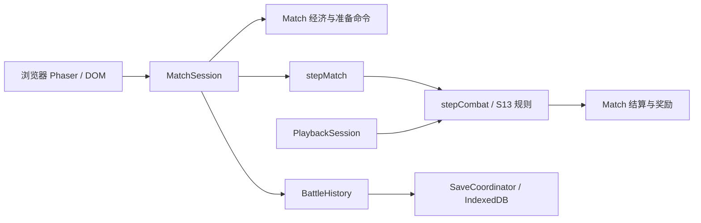
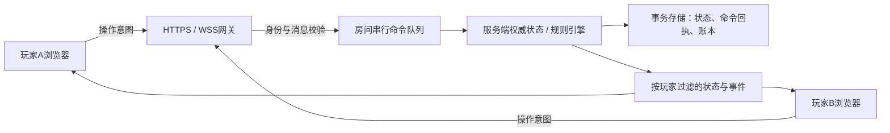

# 服务端权威与朋友联机：有界架构核查

日期：2026-10-11（Asia/Taipei）。本次只核查、验证可运行边界及提出方案，不实施联网、不修改规则合同、不合并或部署。

**结论：当前产品是浏览器本地权威；规则核心已经能在普通 Node 中运行，但仓库没有权威对局服务器。朋友联机需要新增房间、身份、多人 Match 编排、网络协议和服务端持久化；不是仅把现有浏览器加一个 WebSocket。**

## 1. 固定范围与暂停状态

- 核查基线：`c000cacae12b55f7e2fb2c2e8ee57e105314858a`，生产源码树 `370b3bf4da2b0c86f2782f79b5acc7f1e4b46963`。本分支 `docs/server-authority-audit` 没有带入冻结／共享实验代码。
- 暂停实验保存在独立分支 `experiment/m8-static-sharing`，提交 `6304ade117bd247640d875990835ed5631d8199f`，已推送。见[暂停记录](https://github.com/catfish-xn/cat/blob/6304ade117bd247640d875990835ed5631d8199f/docs/M8_STATIC_SHARING_EXPERIMENT.md)。原性能和失败证据未覆盖。
- 暂停时已启动的类型检查和3文件19项边界测试已经完成；没有执行实验的三版性能比较或完整等价验收。Proxy陷阱观察序列已知不兼容，测试通过不表示合同兼容。实验未获正式采用批准。
- PR30/31仍为Draft；main仍为`68ddbb6acc7a0a8659fe3bda59c3612a4a996a37`，没有M8合并或部署。现有5/10ms、GPU和试玩签收状态不变。

## 2. 实际调用链：现在在哪里运行

| 工作 | 真实入口和链路 | 当前执行位置与权威 |
| --- | --- | --- |
| 启动/战斗时钟 | `src/main.ts`创建Phaser；`BoardScene.ts:34`创建MatchSession；`:562`的update调用session.advance(delta)；`match-session.ts`累积50ms后调用stepMatch | 浏览器主线程。隐藏页面、导入、回放等会暂停本地会话；没有远端时钟 |
| 战斗/结算 | `match.ts` startMatchCombat→freezeCombatInput→buildStrategySnapshot→createCombatWithEvents；stepMatch→stepCombat→advanceCombatTick→advanceS13Tick；withCombat/settleRound提交奖励、HP、金币、XP | 同一浏览器JS进程；UI通过事件和状态展示结果 |
| 经济/操作校验 | MatchSession.buy/sell/reroll/buyXp/deploy/combine/equip等直接调用`match.ts`纯函数；校验阶段、钱、所有权、商店generation、轮次等 | 校验确实存在，但由本地客户端调用。没有服务器身份/房间权限校验 |
| 随机数 | `rng.ts`的lcg32-v1；Match持有商店、选择、奖励、战斗种子、装备等显式状态；Combat持有rngState/rngDraws；应用新局由`persistence/seed.ts`使用Web Crypto生成种子/局ID，也允许固定种子 | 种子、随机流和相关计划均在浏览器内存/本地存档；不是服务器秘密 |
| 保存/恢复 | `MatchApplication`订阅SessionChange→BattleHistory/SaveCoordinator→`SaveRepository`；repository使用IndexedDB事务及revision/activationEpoch；导出Blob/JSON；`serialization.ts`纯验证和恢复Match | 浏览器本地。IndexedDB CAS防本地并发覆盖，不是网络身份或服务端数据库 |
| 回放 | `history.ts`校验完整上下文和事件；`PlaybackSession`从初始战斗重新stepCombat，核对事件，维护40tick检查点和1×/2×/4×速度 | 浏览器本地另一个只读模拟；没有决定在线结果的服务器 |
| Node/托管 | 验证脚本通过Node/Vite SSR加载领域源码；`package.json`只有Vite产品构建/开发和测试命令；`.github/workflows/pages.yml`上传dist到Pages | Node用于构建/测试，不是已运行的对局服务；Pages交付静态站点 |

本次检查源码、依赖、Vite配置和全部workflow，未发现产品HTTP/WS对局入口、房间服务、账号服务或服务端数据库。`src/simulation/**/*.ts`未发现Phaser/DOM/IndexedDB/网络/真实时钟依赖。此结论针对仓库与当前交付方式，不声称审计了仓库之外的所有基础设施。

源码入口：[MatchSession](../src/rendering/match-session.ts)、[Match](../src/simulation/match.ts)、[Combat](../src/simulation/combat.ts)、[随机数](../src/simulation/rng.ts)、[应用生命周期](../src/m6/application.ts)、[本地仓库](../src/persistence/repository.ts)、[纯恢复](../src/simulation/serialization.ts)、[回放校验](../src/replay/history.ts)。

## 3. 引擎能否脱离浏览器

**可以。** 新增[有界验证脚本](../scripts/verify-server-engine-portability.cjs)使用esbuild把纯入口构建为Node22 ESM，随后由普通Node子进程执行；不启动Vite、Phaser、浏览器、HTTP监听或联网服务。

实测Node22.23.3：公开seed42首场战斗完成164tick、106事件，playerWin；0/39/40/41/结束点文本及对象存档恢复，完整后续state/events相等；旧generation命令不改变原state；坏digest和删事件回放拒绝；原回放验证及seek通过。构建闭包108项：104个simulation输入，另3个纯回放/limits模块和探针入口；没有rendering/presentation/Phaser输入。证据见[report.json](evidence/server-authority-audit/report.json)。这是一场可移植性探针，不是服务器容量、多人正确性或完整历史验收。

| 可复用 | 实际障碍/迁移边界 |
| --- | --- |
| `src/simulation/`战斗、伤害、装备、经济事务、显式RNG、内容及版本校验 | 有浏览器同样支持的structuredClone、BigInt、Map/Set等标准运行时要求；目前TS扩展省略、JSON导入由Vite处理，需要明确Node构建入口。探针已验证可打包，不等于已交付生产服务包 |
| Match失败不消费资源/RNG、唯一收据、generation/round检查 | TypeScript签名不是不可信JSON的运行时schema；缺少玩家身份、房间归属、命令去重、序列化并发执行和服务端鉴权 |
| 双方Combat解析器、来源账本和完整事件 | `player/enemy`是战斗局部角色，不是两个联网账号；玩家/敌人胜负需要映射到真实playerId |
| `buildStrategySnapshot`的玩家装备/强化编译 | 当前另一方读固定敌军投影；装备/强化/异常绑定存在`team==='player'`分支。9v9测试夹具通过镜像编译组装对手，并未形成公开真人对局接口 |
| Match经济命令与回合结算算法 | `MatchState`只有一份gold/shop/HP/资产；`createRoundEnemies`的pvp也是固定模板。真人对战需房间级玩家状态、双方开战快照和一次性双边结算，不能把两份现有Match各自对固定敌人跑完称为真人对战 |
| 纯serialize/restore、BattleRecord校验、PlaybackSession | restore会验证固定敌军、回合来源和开战上下文；真人对手需要新受信输入合同/版本。不能跳过这些检查塞入另一玩家阵容。`round-N`/`unit-N`等局部ID需房间/玩家映射，不能直接全局复用 |
| 回放/统计数值与渲染消费接口 | `MatchApplication`绑定DOM、页面暂停、IndexedDB；`replay/index.ts`同时导出界面面板。服务端直接导入纯入口，客户端另加远程会话适配器 |

架构判断：**算规则不需要重写；单人Match的多人编排和应用适配需要新增明确边界。** 现有“权威”表示本地规则只有一个入口，不表示已经有可信远程裁判。

## 4. 最小朋友联机方案（设计提案，未开工）

暂按**两位朋友、私密房间、各自准备阵容并1v1**设计首版；不是对8人赛程、匹配、排位或共享有限卡池的承诺。若目标是共同控制同一阵容，权限/准备模型需另定；本轮不把该模式选择当作已批准。建议先保留已有有限内容和独立无限商店，避免首版同时改共享卡池规则。

### 房间与身份

单个Node服务、SQLite事务存储及一个小型战斗worker池足以作为首版架构起点；实际容量要测，暂不引入分布式房间或Redis。通过HTTPS创建/加入邀请房间，服务器分配roomId、playerId、seat；服务器生成不可猜测的会话/重连凭证。房间邀请码用于加入流程，不直接作为座位身份。首版无需完整账号体系，但昵称或客户端自报playerId不能授权操作。

服务器把已认证连接绑定到座位；重连切换连接代次，旧连接不能继续发有效操作。HTTPS/WSS、消息大小/频率限制与版本校验属于这个具体网络入口的最小要求。

### 服务端状态与命令

建议命令包：`{protocolVersion, roomId, commandId, expectedRevision, type, payload}`。actor从服务端会话取得，不信任payload里的身份。只接收买卖、部署、装备、选择、准备等操作意图；客户端不能提交金币、HP、RNG、胜负、任意MatchState或step次数。

处理顺序：消息schema/大小→身份/房间/座位→commandId去重及同ID内容一致性→expectedRevision/阶段→既有规则校验→执行事务→原子持久化state、command回执、事件游标→回复/广播。每房间只有一个逻辑写入者；重复发送返回同一回执，不能再次扣钱或抽随机数。失败仍保持领域state/RNG不变，拒绝原因可记录在服务日志，不混成战斗事件。

房间状态新增`players`、准备状态、配对和battleId；局内Match经济函数作为受控复用点。双方准备提交后，由服务端冻结双方可信资产/阵容，编译带玩家映射的Combat输入；战斗只算一次，把结果映射回双方，并以battleId结算事务去重。双边胜负、伤害/收入、平局、准备截止及掉线后处理属于**新增联机规则合同**，正式批准前不更改M8旧合同。

### 战斗时钟与结果

逻辑步长保持50ms。服务端调度或worker推进stepCombat，服务器决定战斗结束和结算；浏览器帧率、暂停、标签页隐藏、回放速度不会推动或暂停权威战斗。网关不能同步阻塞在整场计算里；worker持有房间/战斗状态，按有界批次交还消息，不每tick跨线程深复制完整Match。

服务端下发带`roomRevision/battleId/tick/eventSeq`的可见状态快照或增量、按序战斗事件和最终结算。发送批次与50ms逻辑tick解耦；不能丢服务端账本。客户端只插值、动画和展示；重放或预测结果不回写权威状态，也不能作为下一回合结算依据。

### 断线重连与持久化

重连携带凭证和最后已应用游标。服务端在一致的revision下补发已保留的连续事件；游标过期则发当前可见快照及其游标，再发送后续事件。客户端发现缺口时请求重同步，不猜测结算。未收到确认的命令使用同一个commandId重试。

服务器继续维护战斗；页面断开不倒退或重开RNG。准备期重连宽限、超时默认动作/认输方式需纳入上述联机合同。客户端断线与服务器进程重启是两件事：首版持久化命令提交及战斗开始/结束，另存周期检查点或保留确定性起点重演，确保进程崩溃后结算也最多一次。服务端记录才是恢复依据，浏览器JSON导入不能覆盖在线房间。

### 客户端展示、隐私与回放

增加RemoteMatchSession/会话接口适配器：当前按钮改为发送意图并等待确认；展示组件继续读投影。LocalMatchSession可保留给离线模式；online路径不再让BoardScene.advance调用权威stepMatch。UI改动另按项目角色范围执行，本次未修改。

**不能把现有MatchState或BattleRecord原样广播。** 它们携带商店、随机流、掉落/装备计划和完整Match context；现有LCG可预测，战斗种子与Match种子有派生关系，简单隐藏几个顶层字段并不等于安全。由服务器定义白名单投影，只发本玩家允许的信息及公开战斗结果；不发内部随机流、未来计划或别人的私有操作。

现有BattleRecord可保留在服务器用于完整确定性复验。在线客户端回放优先用服务端提供的公开关键帧/状态增量和已发生事件，仅控制播放速度/seek，不改变活跃局。若以后需要浏览器独立重算公开回放，必须另定不泄漏未来流的种子与公开回放协议，不能直接复用含完整Match上下文的旧记录。现有contentDigest/回放hash用于一致性校验，**不是服务器认证或反作弊签名**。

## 5. 5/10ms与其他指标如何归属

| 已有指标 | 迁移后的用途 | 本次处理 |
| --- | --- | --- |
| 纯领域tick p95≤5ms / p99≤10ms | 仍适用于服务端复用引擎的CPU成本和回放计算；原Node/Vite SSR脚本不是浏览器渲染计时 | 目标、原18单位54装备、两种9v9、30公开路线和采样均保留。生产Node bundle另做配对测量，不能改名冒用原SSR数据 |
| 固定50ms/tick | 模拟规则的离散时间步长；不是CPU耗时门槛，也不是网络往返目标 | 不改变。5ms预算给调度和多对局留余量，但p95不能直接换算每核房间数 |
| 桌面帧间隔p95≤33.3ms / p99≤50ms | 浏览器呈现、动画和交互 | 仍须硬件GPU验收；服务器CI/CPU达标不能替代 |
| JS gzip≤M7×1.30、首次可操作中位数≤M7×1.20 | 浏览器资源和启动体验 | 保留。以后拆客户端/服务端产物时分别重测，不自动放宽 |
| IndexedDB写入、导入激活、seek、40tick统计、256MiB/100000事件/3完成局等 | 现有离线/回放产品合同 | 当前功能保留原门槛；不是服务端数据库、网络包大小或在线保留期的既定SLO |
| 服务器新指标 | 命令排队/确认延迟、完整战斗耗时、事件循环延迟、并发房间、CPU/内存、持久化、带宽和重连恢复 | 建立独立负载模型及测量后提出目标，不能用单tick指标替代这些验证 |

当前c000对应实测代码cf76：distinct p95/p99=16.843/31.758ms，mirror=15.337/25.477ms，仍未达5/10；公开路线合并3.863/6.320ms通过，但16/30单路线p95回退，总脚本墙钟1407681→1508592ms。原因尚未解决，必须保留；它们也会影响将来的服务端吞吐/队列，不能因目标转为联机就注销。冻结实验现已暂停，不把未做的三版比较写成结论。

## 6. 当前M8边界与最小迁移顺序

M8已有的价值是有限内容与装备机制、单人经济/回合、确定性战斗、完整账本、保存/回放及对应功能证据；固定f58功能审查范围内无新P1/P2。当前M8为38轮/33战的单人流程，节点三性能/GPU/试玩仍未完成；功能证据不等于M8整体签收，更不等于联机就绪。M9现有文档主要是英雄/羁绊内容扩展，也不是服务器实现。

| 步骤 | 最小产出 | 必须验证 |
| --- | --- | --- |
| N0 明确合同 | 批准首版两人私房1v1或其他模式；确认独立经济/商店、准备截止、平局/掉线处理、信息可见性和新协议版本 | 逐项列出相对M8变化；保留离线合同，不把同房间各跑PvE作为真人对战验收 |
| N1 规则服务化薄切片 | 纯引擎Node构建入口；一个权威房间、身份和单写队列；先用现有M8公开路线贯穿命令→持久化→投影 | 同输入全state/events/RNG与现有引擎一致；伪造身份、错误类型/版本、旧revision、重复命令、越权操作拒绝；这一阶段还不是完整1v1产品 |
| N2 双玩家领域编排 | 双方资产/准备状态；安全的双方快照编译；战斗角色/ID映射；一次战斗、双边结算；新恢复/回放合同 | 两个独立浏览器各控制自己阵容；双方装备/强化/异常生效；同seed换边/ID映射等价；胜负/平局/同时死亡与双方经济、RNG、唯一收据的独立预期；旧M8仍回归通过 |
| N3 远程展示与恢复 | Remote会话适配、按权限投影、事件序列/快照、重连与服务端恢复、公开回放 | 篡改浏览器金币/胜负/本地存档不能影响服务端；重复/乱序/缺失消息、断网、旧连接、崩溃前后提交均不重扣/重发；回放/隐藏页面不暂停权威局；无未来RNG泄露 |
| N4 部署前验收 | 固定版本、候选服务器环境、原CPU回归和小规模多房间负载报告、两个真实客户端试玩 | 保留5/10ms及原工作量，解释公开路线回退；补队列/存储/网络性能；浏览器硬件GPU和试玩独立签收；通过后再申请部署批准 |

**建议：先批准N0范围并推进N1的服务端权威薄切片。当前没有必要先批准冻结／共享的正式合同；性能工作应在确认的服务端入口和目标负载下继续，原失败仍保留。** 本次未创建房间服务、修改正式合同、改变门槛或启动N1施工。
